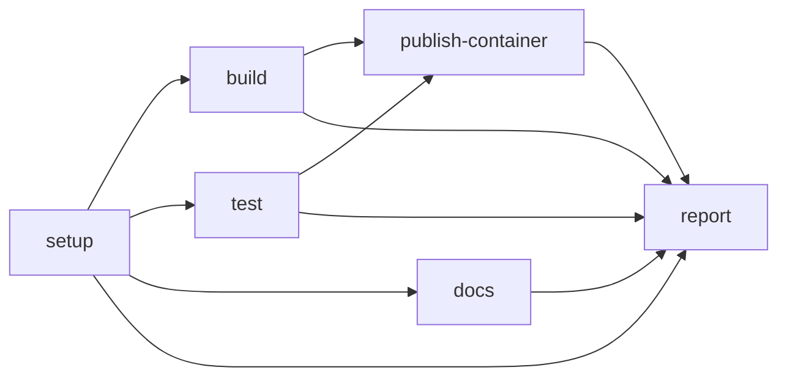

# Dashboard

Local markdown dashboard for systems and links. The board is stored in a file on this machine.

## Install

The running app is the container image. This repository does not publish a GitHub release.

### Container

```sh
podman pull ghcr.io/rbe/dashboard:latest
```

The image is `linux/amd64`. `make run` builds it locally and listens on https://127.0.0.1:4173. The certificate is self-signed. The first launch writes it to `data/tls/cert.pem`, and the browser asks before trusting it.

### npm

The command is `dashboard`. Install it from a checkout:

```sh
npm install -g .
```

`npm install -g dashboard` does not install this project. That name on the public npm registry already belongs to a different package. This repository does not publish an npm package.

## Run from a checkout

```sh
npm install
npm start
```

The dev server listens on http://127.0.0.1:5173. `npm run preview` builds and serves the production UI on https://127.0.0.1:4173. That server uses a self-signed certificate, `data/tls/cert.pem` and `data/tls/key.pem`, and creates the pair when it is missing. An expired pair is replaced. `--cert` and `--key` (or `DASHBOARD_TLS_CERT` and `DASHBOARD_TLS_KEY`) select different files.

```sh
dashboard --help
dashboard --port 4173 --file data/dashboard.md
```

`PORT` and `DASHBOARD_FILE` set the same values. The default file is `data/dashboard.md` in the current directory.

## Podman

Podman and make are enough to build and run the app. Node.js and TypeScript are not required on the host; the image installs them and compiles the UI.

```sh
make run
```

Open https://127.0.0.1:4173. `make run` builds the image, starts the container in the background, and `make stop` stops and removes it. The board file is `data/dashboard.md` in this directory, mounted into the container, and the self-signed certificate is written to `data/tls/` there. `make run PORT=9000` listens on that port.

`make help` lists every target. A description that starts with "Match CI" is a job the GitHub workflow runs, so a laptop and CI share one command. Podman is the only container engine. `make ci` runs `setup`, `build`, `test`, `docs`, and `report` on a laptop. It does not publish.

## Pipeline

Job rules are in [docs/pipeline-rules.md](docs/pipeline-rules.md). Podman and make are enough to set the app up. `make setup` installs dependencies with `npm ci` in the Node 24 image and runs `npm audit` as a warning. It saves `node_modules` for the jobs that follow. The only workflow is `.github/workflows/ci.yml`. Each job runs the Makefile target with the same name. The workflow logs in with `make login`, then `publish-container`, then `cleanup-container-versions`. `login` reads `REGISTRY_USER` and `REGISTRY_TOKEN`. The image name `ghcr.io/rbe/dashboard` is a workflow variable. The version is the nearest v* tag, not the `package.json` version.



A line is that job's `needs` entry. `build`, `test`, and `docs` each wait for `setup`, then run together. `docs` needs only `setup`. It renders `docs/` to HTML beside `build` and `test`, on every push, and that HTML stays out of the image. `publish-container` waits for `build` and `test`. It pushes the image `build` saved. `report` is last. It waits for `publish-container` and the jobs before it, then collects make output, script output, test results, coverage, and publish results into one artifact. It still runs when `publish-container` is skipped or fails.

A push to `master` runs `setup`, then `build`, `test`, and `docs` together, then `publish-container`, then `report`. Any other branch skips `publish-container`. `report` still runs. A tag push does not start a run. Delivery is the container image. This repository does not publish a GitHub release. When `publish-container` runs, it pushes `ghcr.io/rbe/dashboard:<version>-<run>` and `ghcr.io/rbe/dashboard:latest`. `<version>` is the nearest v* tag on the commit with the leading `v` removed, and `<run>` is the GitHub run number. It does not push `edge`, a bare version, or `sha-<commit>`. If no `vMAJOR.MINOR.PATCH` tag describes the commit, the publish fails and does not invent a version. After that push succeeds, `cleanup-container-versions` keeps the current published version and exactly one former, and deletes every older package version. `latest` is a tag on the newest version, not another package version. A skipped or failed publish deletes nothing. **Run workflow** starts the one selected job on the chosen branch, and that manual publish may push. Choosing `publish-container` also runs `setup`, `build`, and `test`, and that run publishes the image with the same tags. Choosing `report` runs `setup`, `build`, `test`, and `docs`, and does not publish. `report` then writes the artifact.

The workflow and the image use Node 24. `make image` passes that same major into the image.
