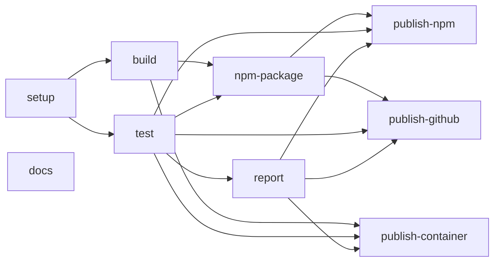

# Dashboard

Local markdown dashboard for systems and links. The board is stored in a file on this machine.

## Install

The running app is the container image. A GitHub release attaches the npm tarball.

### Container

```sh
podman pull ghcr.io/rbe/dashboard:latest
```

The image is `linux/amd64`. `make run` builds it locally and listens on https://127.0.0.1:4173. The certificate is self-signed. The first launch writes it to `data/tls/cert.pem`, and the browser asks before trusting it.

### npm

The command is `dashboard`. Install it from a checkout:

```sh
npm install -g .
```

Or from a GitHub release tarball:

```sh
npm install -g https://github.com/rbe/dashboard/releases/download/v1.0.0/dashboard-1.0.0.tgz
```

`npm install -g dashboard` does not install this project. That name on the public npm registry already belongs to a different package. Publishing this package there stays off until the repository variable `NPM_PUBLISH` is `true` and the `NPM_TOKEN` secret is set. A manual run of the `publish-npm` job may publish without that variable.

## Run from a checkout

```sh
npm install
npm start
```

The dev server listens on http://127.0.0.1:5173. `npm run preview` builds and serves the production UI on https://127.0.0.1:4173. That server uses a self-signed certificate, `data/tls/cert.pem` and `data/tls/key.pem`, and creates the pair when it is missing. An expired pair is replaced. `--cert` and `--key` (or `DASHBOARD_TLS_CERT` and `DASHBOARD_TLS_KEY`) select different files.

```sh
dashboard --help
dashboard --port 4173 --file data/dashboard.md
```

`PORT` and `DASHBOARD_FILE` set the same values. The default file is `data/dashboard.md` in the current directory.

## Podman

Podman and make are enough to build and run the app. Node.js and TypeScript are not required on the host; the image installs them and compiles the UI.

```sh
make run
```

Open https://127.0.0.1:4173. `make run` builds the image, starts the container in the background, and `make stop` stops and removes it. The board file is `data/dashboard.md` in this directory, mounted into the container, and the self-signed certificate is written to `data/tls/` there. `make run PORT=9000` listens on that port.

`make help` lists every target. A description that starts with "Match CI" is a job the GitHub workflow runs, so a laptop and CI share one command. Podman is the only container engine. `make ci` runs the jobs through `report` and `docs` on a laptop. It does not publish.

## Pipeline

Podman and make are enough to set the app up. `make setup` checks that a `v*` tag matches `package.json`, installs dependencies with `npm ci` in the Node 24 image, and runs `npm audit` as a warning. It saves `node_modules` for the jobs that follow. The only workflow is `.github/workflows/ci.yml`. Each job runs the Makefile target with the same name. The image name `ghcr.io/rbe/dashboard` and the package version are workflow variables.



A line is that job's `needs` entry. `build` and `test` both wait for `setup`, then run together. `npm-package` waits for both and packs the `dist` tree `build` uploaded. `report` waits for `test` and collects coverage and test output when `test` wrote them. `docs` has no `needs`. It renders `docs/` to HTML beside the other jobs, and that HTML stays out of the npm package and the image.

A push to `master` or `main` runs `setup` through `report`, with `docs` beside that chain, then the three publish jobs. They wait only on the jobs drawn above. A push to any other branch stops after `report` and does not publish. A tag `vX.Y.Z` that matches `package.json` also runs the three publish jobs. `publish-container` on `master` or `main` pushes `ghcr.io/rbe/dashboard` as `edge` and `sha-<commit>`. On a `vX.Y.Z` tag it pushes `X.Y.Z`, `X.Y`, `X`, and `latest`. `publish-github` attaches the tarball from `npm-package`. `publish-npm` publishes that tarball when the repository variable `NPM_PUBLISH` is `true`. A manual run of `publish-npm` may publish without that variable. **Run workflow** starts the one selected job on the chosen branch, including a publish job, and that manual publish may push. Choosing `publish-npm` or `publish-github` also runs the jobs that produce the tarball. Choosing `publish-container` also runs `build`, which saved the image. A manual `publish-container` on `master` or `main` pushes `:edge` and `:sha-<commit>`. A manual run on any other branch pushes `:sha-<commit>`.

The workflow and the image use Node 24. `make image` passes that same major into the image.
